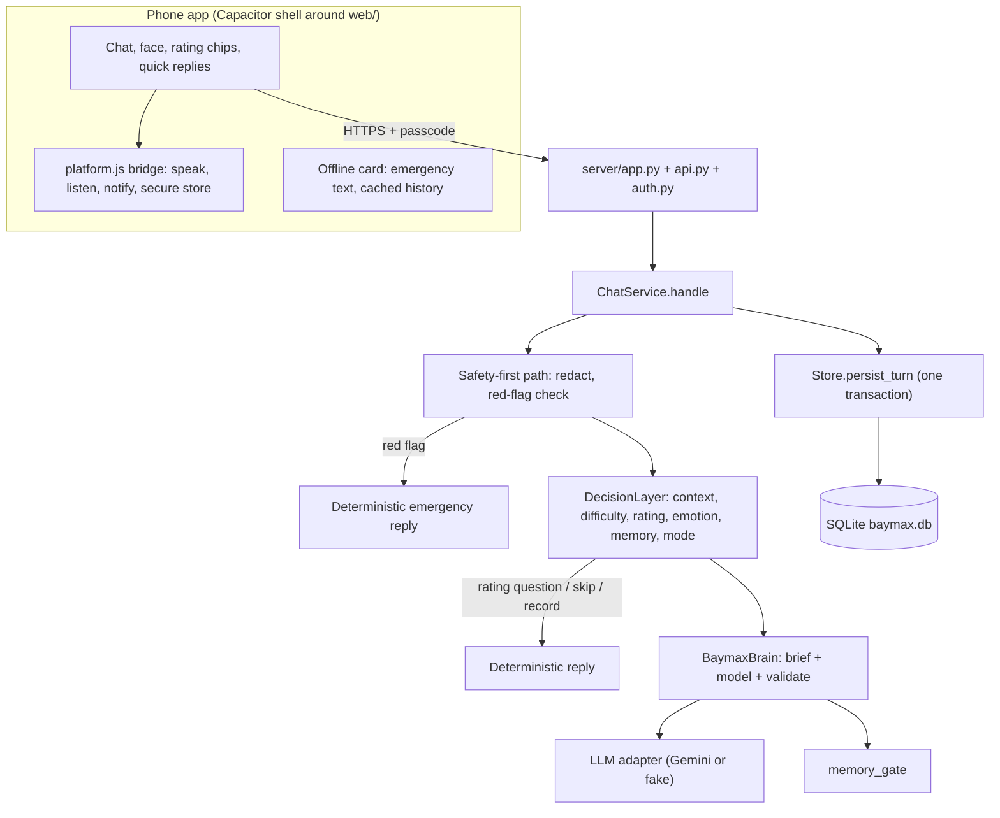
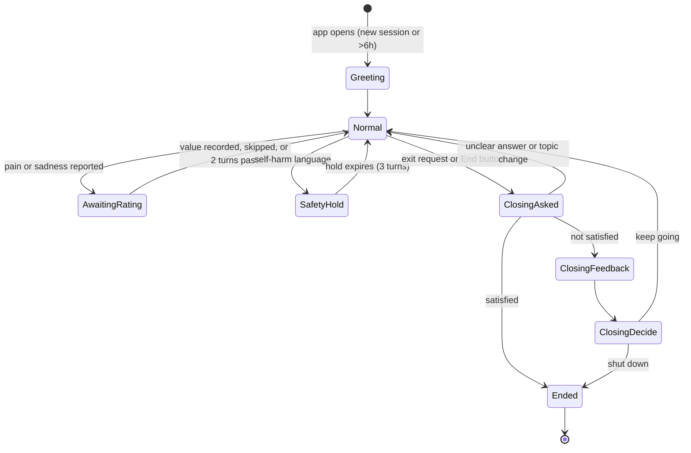

# Claude Architecture Handoff — Tiny Baymax

## Purpose

Claude is the architecture owner for the next iteration of Tiny Baymax. Review the existing implementation when it is supplied, design the target architecture, and maintain this file as the authoritative architecture specification. ChatGPT implements against the approved specification and maintains `IMPLEMENTATION_LOG.md`. Claude reviews the implementation against the spec and identifies gaps.

## Project context (reported by the user; verify against source when available)

- Project name: Tiny Baymax / Baymax.
- Prototype originally reported by the user: v0.5.1 (Google Colab / Python, Gemini API, Google Drive memory at `/content/gdrive`).
- **Source review correction (2026-10-12):** the source actually supplied is **v0.6.0**, a Python server project (SQLite storage, JSON API, passcode auth, installable web app). Colab and Drive are no longer part of the runtime. See section A.
- Online model: Gemini API. `gemini-3.5-flash-lite` is historical/current configuration, not a guaranteed valid identifier. Verify against Google's model list.
- Goal: evolve into a maintainable, testable personal healthcare companion **mobile app**. Not a substitute for professional medical care.

## Non-negotiable product behavior

1. At startup, introduce itself as: **“Baymax, your personal healthcare companion.”**
2. When a user reports pain or sadness, request an immediate severity rating at that point in the conversation. This rating is specifically for pain/sadness, not a generic conversation score. Make the scale explicit and consistent, and allow the user to skip or correct it.
3. Before a normal shutdown, ask: **“Are you satisfied with my care today?”** Wait for the user's response before giving the closing message. Do not trap the user in an endless loop; provide a clear exit path.
4. Keep memory handling transparent and controllable. Avoid storing sensitive health details by default without an explicit, understandable consent design.
5. Keep credentials out of source control. Read API keys from environment variables or Colab Secrets; never put real keys in code, notebooks, logs, or committed example files.
6. Treat medical safety as a first-class requirement. Do not diagnose with certainty, do not imply emergency services have been contacted, and route urgent danger / emergency symptoms to appropriate local emergency support. State that this is supportive information, not professional medical advice.
7. Gracefully handle unavailable model APIs, quota/rate limits, network failures, malformed responses, and missing Drive mounts. The app should explain the issue and avoid losing existing memory.
8. Keep the user's data portable and provide a way to inspect, export, and delete stored memory.
9. Preserve working behavior unless the specification explicitly changes it. Do not silently change versions or break existing memory files.

Project-level rules from the user (also binding): Gemini is the language brain only, Python enforces everything safety-critical; ratings are never asked at shutdown; memory is stable non-sensitive facts only; simulated emotion must change behaviour and is never claimed as real feeling; caring but never clingy; never invent implications about the user; user can always inspect/delete/export/exit; write new dialogue in Baymax's manner, no film lines, no voice cloning.

## Architecture work requested from Claude

(Unchanged from the original handoff: sections A to E covering current-state assessment, target architecture, conversation/state requirements, privacy and safety, and migration/acceptance criteria. Each is answered below.)

## Architecture status

**Status: Draft, scope is "simple first" (section H). Phase 1 and 2 ready; Phase 3 (Android) unblocked.** User decisions of 2026-10-17 are recorded in section F. PR #1 review findings F1-F12 are tracked in `REVIEW_PR1.md` and must be fixed before merge.
- **Ready for implementation now:** Phase 1 (hardening, v0.6.1) and Phase 2 (real-world verification). They need no user decisions.
- **Phase 3 (Android shell):** unblocked by decisions F-1 and F-2. Phase 4 (reminders) still waits on F-5.
- **Source not yet reviewed:** `tests/` and `web/` were not in the bundle. Statements about them are assumptions.

---

## Architecture specification

### A. Current-state assessment

#### A.1 Verified from source (v0.6.0 code bundle)

| Area | Observation |
|---|---|
| Layering | `server/` (transport) → `service.py` (commands, shutdown ritual, sessions, persistence) → `brain.py` (decide → generate → validate) → `decision.py` / `llm/` / `safety.py`; `storage.py` is SQLite. Clean and matches `docs/ARCHITECTURE.md`. |
| Greeting | `GREETING` constant; `open_session` appends it once per session and again after 6 hours. Matches rule 1. |
| Ratings | `DecisionLayer` asks a 0-10 question deterministically for pain and emotional difficulty. The model is not called for that turn. Rating is parsed while `awaiting_rating_until` holds (2 turns). Injury, symptom and "other" difficulties are deferred (a clarifying question, no rating). |
| Red flags | Self-harm and urgent-medical patterns return fixed Python replies without the model. Self-harm starts a 3-turn safety hold. |
| Shutdown | `closing` state: asked → (feedback → decide) → ended. Feedback goes to its own table. |
| Memory | `memory_gate` regex block-list, 200-char cap, duplicate check, auto-save disabled during difficulty turns. Max 100 memories per user. |
| Secrets | `redact_secrets` runs before the model and before storage. A message that is only a secret is answered without the model. |
| Emotion | Six simulated values; relax toward baseline; `style()` changes tone, humour, length and question budget through the decision brief. |
| Auth/API | Per-user passcode header, constant-time compare, 16 KB body cap, strict CSP on static files. Gemini key is server-side only. |
| Gemini adapter | Isolated in `llm/gemini.py` with retry/backoff on 429/5xx and optional fallback model. |

#### A.2 Defects and gaps found by reading the source

Severity: **S** = violates a non-negotiable, **M** = reliability/security, **L** = polish.

| ID | Sev | Finding | Where |
|---|---|---|---|
| G1 | S | **No skip or correct for ratings.** The question never offers "skip". After a rating is recorded, `awaiting_rating_until` is set to -1, so "actually it's 6" is treated as normal chat. Violates rule 2 of the handoff. | `decision.py`, `detection.parse_rating` |
| G2 | S | **A rating is lost if the model call fails.** `decide()` sets `ep.rating` and clears the awaiting flag, then the model is called. On `llm_failed` or `used_fallback`, `service._chat` returns before `add_rating`. The user's next answer is then not parsed as a rating. | `service._chat`, `brain.turn` |
| G3 | S | **"very" counts as satisfied.** `YES` contains `very`, so "very disappointed" ends the ritual as satisfied. | `service.YES` |
| G4 | M | **Shutdown ritual triggers only on exact words** (`bye`, `quit`, `exit`, `/quit`, `/exit`). "goodbye", "I'm done", "good night" do not start it, and there is no end-session button defined for a mobile app. | `service.QUIT_WORDS` |
| G5 | M | **Feedback text is stored unredacted.** The shutdown feedback path writes raw `text` to `feedback`, bypassing `redact_secrets`. | `service._handle_locked` |
| G6 | M | **Redaction misses spaced numbers.** `\b\d{12,}\b` does not catch card numbers or 12-digit national ID numbers written with spaces or dashes (for example `1234 5678 9012`). Relevant for an India-based user. | `safety.SECRET_RX` |
| G7 | M | **No global error handling in the HTTP handler.** An exception in `dispatch` (for example a SQLite error) closes the connection with no response, so the client sees a network failure. A bad `Content-Length` header can also raise. | `server/app.py` |
| G8 | M | **No CORS or `OPTIONS` handling.** A mobile webview that calls the server cross-origin gets blocked (and `OPTIONS` returns 501). Blocks the mobile shell. | `server/app.py` |
| G9 | M | **Failed-login slowdown is per request, not per client.** A 0.3 s sleep on a threaded server does not throttle parallel guessing. | `server/app.py`, `auth.py` |
| G10 | M | **Persistence is not atomic.** A turn writes history, emotion, rating, memory and usage in separate commits. A crash between them leaves inconsistent state. | `service._chat`, `storage.py` |
| G11 | M | **No schema versioning.** The schema uses `CREATE TABLE IF NOT EXISTS` only, so adding a column later has no safe path. | `storage.py` |
| G12 | M | **Emergency replies depend on storage.** `_chat` loads emotion/history/memories before `decide()`. If SQLite fails, the red-flag path is never reached. Safety replies must not depend on storage or the model. | `service._chat` |
| G13 | M | **Numeric parse can capture the wrong number.** While awaiting a rating, "I took 2 pills" (4 words) records a rating of 2, and "about a six I think" (5 words) is missed. | `detection.parse_rating` |
| G14 | M | **No per-item delete for ratings and no edit.** Memories have per-item delete; ratings only have delete-all. | `storage.py`, `api.py` |
| G15 | L | **No visible "supportive information, not medical advice" statement** in the urgent-medical reply or any defined UI element (handoff rule 6). The persona says it, but nothing guarantees the user sees it. | `decision.py` |
| G16 | L | **Deterministic replies use contractions** ("I'm glad", "let's continue") while the persona asks for few contractions. Small voice inconsistency. | `decision.py`, `service.py` |
| G17 | L | `delete_all` pops `svc._sessions` directly (private attribute) from the API layer. Add a `ChatService.forget_user(uid)` method. | `api.py` |
| G18 | L | Session state (open rating, ritual step, safety hold) lives in process memory and is lost on restart. Acceptable for one process; document it, and persist it only if the server ever runs multi-process. | `service.py` |

#### A.3 Unknowns (not verified)

- U1: Behaviour against the real Gemini API: model name validity, structured-output schema acceptance, and whether the 700-token output cap truncates JSON for models that spend tokens on internal reasoning.
- U2: `web/` (UI, face, voice, service worker) and `tests/` (48 tests). Not supplied.
- U3: HTTPS access from a phone (Tailscale, tunnel or cloud).
- U4: Whether v0.5.1 Drive memory/state files were migrated into SQLite. No importer exists in the bundle, and no sample files were supplied.
- U5: Android vs iPhone, and where the server will run.

---

### B. Target architecture

#### B.1 Principle (unchanged)

The model words replies; deterministic Python decides and enforces anything safety-critical. The **phone app is a thin client**. It adds device capabilities (voice, notifications, secure storage) and owns no behaviour rules.

#### B.2 Data flow

#### B.3 Conversation state model

Rules for the diagram: urgent-medical and self-harm detection are evaluated in **every** state, including the closing states. A red flag during the ritual answers the red flag first and leaves the ritual state unchanged (see B.5).

#### B.4 Module responsibilities and contracts

Existing modules keep their roles and signatures. Changes are additive.

**`detection.py`**
- New: `parse_rating_reply(text: str) -> RatingReply` where `RatingReply(kind: "value" | "skip" | "correction" | "ambiguous" | "none", value: Optional[int])`.
- `parse_rating` stays for compatibility and calls the new function.
- Accepts: digits 0-10, number words, "N out of 10", "N/10", phrasing like "about a six", up to 8 words.
- Rejects as `none`: any text containing a time token (`am`, `pm`, `:`) or a second number.
- Two different candidate numbers → `ambiguous` → Python asks one confirmation ("Did you mean 7?") and records nothing until confirmed.
- Skip phrases ("skip", "rather not say", "no rating", "pass") → `skip`.
- Correction phrases ("actually", "I meant", "change it to") + number, within 3 turns of a recorded rating → `correction`.

**`decision.py`**
- Rating question text must state the scale and the skip option, in Baymax's manner. Example shape: "How would you rate the pain from 0 to 10? You can also say skip." (Exact wording is for ChatGPT to propose within Baymax's voice rules; I review it.)
- `Decision` gains `ui_hint: Optional[dict]` (see B.6) and `rating_action: "none" | "ask" | "record" | "skip" | "correct" | "confirm"`.
- `Episode` gains `rating_turn: Optional[int]` to bound the correction window.
- The safety-first split: add `DecisionLayer.safety_check(msg) -> Optional[Decision]`, a pure function that returns a deterministic emergency/self-harm decision using detection only (no emotion, memory or storage needed). `decide()` calls it first.

**`service.py`**
- `ChatService.handle` order becomes: empty check → **red-flag check (all states)** → closing ritual state → exit intent → commands → chat.
- Exit intent is `is_exit_intent(text) -> bool`: the existing words plus `goodbye`, `good night`, `i'm done`, `i am done`, `that's all`, `see you`; matching only when the whole message is short (≤5 words), so "I am done with my project" does not end the session.
- New: `ChatService.end_session(uid)` (used by an End button) enters `ClosingAsked`.
- `YES` removes `very` and `sure` alone. "very satisfied" and "not satisfied" are handled by an ordered check: negations first, then affirmations.
- Feedback text passes through `redact_secrets` before `add_feedback`.
- New: `ChatService.forget_user(uid)` clears the session and calls `Store.delete_all`.
- `_chat` is split into `_decide`, `_generate`, `_persist` so that persistence of the decision outcome never depends on the model result (fix for G2). Required behaviour: **if a rating was recorded or skipped this turn, it is persisted even when the model call fails.**

**`storage.py`**
- New: `persist_turn(uid, pairs, emotion, rating_event=None, memory=None, bump=True)` doing all writes in one transaction.
- New: `delete_rating(uid, rating_id)`, `update_rating(uid, rating_id, value)`.
- Schema versioning: use `PRAGMA user_version`. Keep an ordered list of migration functions; on startup, back up the DB file (SQLite online backup API) then apply pending migrations. Current schema = version 1.
- New: `Store.health() -> dict` (`{"ok": bool, "schema": int}`).

**`safety.py`**
- Extend `SECRET_RX` to catch digit groups that total 12-19 digits with spaces or dashes between groups (card numbers, 12-digit national IDs). Add tests with spaced and dashed forms. Keep false-positive risk in mind: phone numbers with 10 digits must not be redacted by this rule.
- No change to `memory_gate` behaviour (see decision F-4 about explicit saves).

**`server/app.py`, `api.py`, `auth.py`**
- Wrap `_api` in try/except: unexpected errors return `500 {"error": "...", "code": "server_error"}`; `sqlite3.Error` returns `503 {"error": "...", "code": "storage_unavailable"}`; invalid `Content-Length` returns 400.
- Add `do_OPTIONS` and CORS: only origins listed in a new `BAYMAX_ALLOWED_ORIGINS` setting (comma-separated, default empty = no CORS). Allowed headers include `X-Baymax-Token, Content-Type`. Never use `*`.
- `Auth`: add failed-attempt lockout per client address (for example 5 failures → 60 s block), with an injectable clock for tests. Return 429 with `code: "too_many_attempts"`.
- `/api/health` returns `{"ok": true, "version": "...", "storage": "ok" | "unavailable"}`.
- Startup: if `data_dir` is not writable or the DB cannot open, exit with a clear message. Do not silently create an empty database elsewhere.
- New endpoints are listed in B.6.

**`config.py`**
- New settings: `BAYMAX_ALLOWED_ORIGINS`, `BAYMAX_BACKUP_KEEP` (default 7). Update `.env.example`. No other change.

#### B.5 Failure behaviour (contract)

| Failure | Required behaviour |
|---|---|
| Gemini unreachable / quota / bad JSON | Existing: friendly error reply, `kind: "error"`. **New:** rating/emotion decided this turn are still persisted (G2). Red-flag replies are unaffected because they never call the model. |
| SQLite unavailable at runtime | Red-flag and self-harm messages still get their deterministic reply (G12). Everything else returns 503 `storage_unavailable` with a plain message. No partial writes. |
| Data directory missing/unwritable at startup | Refuse to start with an actionable message. Never overwrite or recreate an existing DB. |
| Server unreachable from the phone | App shows a banner and the **offline emergency card** (static text using the configured emergency hint, stored in the app after the first successful session). Messages are not queued, so stale health text is never sent later. |
| Migration failure | DB restored from the pre-migration backup; server refuses to start; log says which step failed. |
| Red flag during the shutdown ritual | Emergency reply first. Ritual state is preserved so the user can still finish or continue. |

#### B.6 API contract changes (additive only; no existing field removed or renamed)

Existing responses keep `reply, kind, mode, ended, closing, emotion`. Added:

- `ui` (optional object) on chat responses:
  - `{"rating": {"min": 0, "max": 10, "about": "pain" | "feeling", "skippable": true}}` when the server just asked a rating question or is waiting for one. The app renders tappable 0-10 chips plus a Skip button. Chips send the plain text of the number (or `skip`) through the normal `/api/chat` path, so there is one parsing path.
  - `{"quick_replies": ["Yes", "No"]}` during `ClosingAsked`; `["Keep going", "Shut down"]` during `ClosingDecide`.
  - `memory_saved` stays as it is today (a bare string or null). **Decision F-3 (2026-10-17): auto-save is silent.** The app shows no "Saved" notice and no Undo. Saved facts are still listed in Settings, where each can be deleted.
- `POST /api/session/end` → enters `ClosingAsked` (End button).
- `DELETE /api/ratings/{id}`, `PATCH /api/ratings/{id}` with `{"rating": 0-10}`.
- Error responses add `code` next to the existing `error` string.
- Request header `X-Baymax-TZ` (IANA name, optional) used from Phase 4.

---

### C. Conversation and state requirements

"Now" = v0.6.0 status. Target is the required behaviour after Phase 1 unless noted.

| # | Scenario | Required behaviour | Now |
|---|---|---|---|
| C1 | Startup | Greeting text exactly as in the non-negotiables, then "How are you feeling today?". Once per session and after 6 h. | Met |
| C2 | Ordinary conversation | Model replies under the decision brief. No rating prompt. No question on every turn (budget). | Met |
| C3 | Pain disclosure | Immediate deterministic 0-10 question, scale and skip stated. Model not called. | Partly (G1) |
| C4 | Sadness disclosure | Same, worded for how the person is feeling. | Partly (G1) |
| C5 | Follow-up while awaiting | Numeric answer recorded. Non-numeric follow-up goes to the model with the same episode, no re-ask. Ambiguous → one confirmation. | Partly (G13) |
| C6 | Skip or correct | "skip" ends the wait, records nothing, and Baymax moves on without pressure. A correction within 3 turns updates the stored value; ratings can also be edited or deleted in settings. | Missing (G1, G14) |
| C7 | Topic change mid-flow | After 2 turns the wait expires silently. A message clearly unrelated to a rating (time, longer text) is treated as chat, not a rating. | Partly (G13) |
| C8 | Exit words | Broader exit intent (B.4) and an End button start the ritual. A long sentence containing "done" does not. | Partly (G4) |
| C9 | Satisfaction question | Exactly "Are you satisfied with my care today?" Closing message only after an answer. Unclear answer → carry on as normal chat, so the user is never trapped. "No" → feedback → keep going or shut down. | Partly (G3) |
| C10 | Urgent risk language | Deterministic reply, calm, tells the person to contact local emergency support, never says help was contacted, states that this is supportive information and not medical advice. Works with no model and no storage, in any state. | Partly (G12, G15) |
| C11 | Model request fails | Friendly error, no crash, rating/emotion already decided are not lost. | Partly (G2) |
| C12 | Storage missing | Startup refusal or 503 as in B.5; emergency path still works at runtime. | Missing (G7, G12) |

---

### D. Privacy and safety

**Consent.** The first run of the app shows one plain-language screen before the first chat message:
1. Messages are sent to Google's Gemini service. On free tiers Google may use content to improve its products. Use a paid-tier project before anyone else uses the app. Check Google's current terms; this document makes no claim about them.
2. What is stored on the server (history, memories, ratings, feedback, settings) and that the user can view, export and delete all of it.
3. Auto-memory is **on** by default and saves silently. Say that plainly here, and that saved facts can be viewed and deleted in Settings, and auto-memory turned off there.
4. Baymax is not a doctor and the app is not a medical device.

Consent state is stored as a setting (`consented_version`). Bumping the consent text version re-prompts.

**Data minimisation.** Messages stored are the redacted text. Health, mood, medication, injury, finance, exact location, relationship details, politics and secrets never auto-save to memory (existing gate, unchanged). Feedback is stored separately and, after G5 is fixed, redacted.

**Retention (current limits, made explicit).** Messages: last 300. Memories: max 100. Ratings, feedback, usage: kept until the user deletes them. Optional later: a "keep ratings for N days" setting. No automatic deletion is introduced without a user decision.

**User controls (all required in the app).** View, delete one, and delete all memories; view, edit and delete ratings; clear history; reset emotion; export all data as JSON; delete everything (typed confirmation `DELETE`); End session.

**Secrets.** The Gemini key lives only in server `.env`. It never goes to the app. The app stores only the server URL and the user's passcode, in the platform secure store (Android Keystore / iOS Keychain through a plugin), not in plain web storage. `.env` and `data/` are in `.gitignore`. Server logs never contain message content.

**Safety boundaries.** No diagnosis, no invented cures, no claim that emergency services were contacted, and the emergency number text comes from `BAYMAX_EMERGENCY_HINT`. Keyword detection can miss unusual phrasing. This stays a documented limit, and the user keeps `/debug` to inspect a turn.

**Compliance.** No claim of regulatory compliance (medical device rules, data-protection law) is made or implied. Treat any future public release as needing a separate legal review.

**Testable privacy requirements** are listed as AC-9 to AC-14 in section E.

---

### E. Migration, acceptance criteria and test plan

#### E.1 Phased migration

Each phase ends with all tests green and a short entry in `IMPLEMENTATION_LOG.md`. Do not start a phase until the previous one is merged.

**Phase 0: Repository hygiene (required, small).**
1. Create the GitHub repo. Add `.gitignore` with `.env`, `data/`, `__pycache__/`, `mobile/node_modules/`.
2. Commit `docs/`, this file and an `AGENTS.md` containing the non-negotiable rules and engineering rules above.
3. Add a GitHub Actions workflow that runs `python -m unittest discover -s tests -t .` on every pull request.
4. Add `tests/` and `web/` to the repo (they were missing from the bundle) so they can be reviewed.

**Phase 1: v0.6.1 hardening (required).** Patch release; no breaking API change.
Implement in this order, each with tests: G3, G5, G2 + G10 (`persist_turn`), G12 (safety-first path), G1 + G13 + G14 (rating flow), G4, G7, G6, G9, G11 (schema versioning), G15, G17. G16 and G18 are optional. Files touched are listed in B.4.

**Phase 2: Real-world verification (required, mostly the user's actions).**
1. Run with `BAYMAX_LLM=gemini` and a real key. Confirm the model name, structured output, valid JSON on 20 varied messages, and that replies are not truncated (U1). Record results in the log.
2. Run the web app over Tailscale on the real phone (U3). Check chat, face, voice in/out, install-to-home-screen, and what happens when the server is stopped mid-chat.
3. Fix only what verification proves broken, as separate small commits.

**Phase 3: v0.6.2 mobile shell (required for a mobile app; blocked on F-1 and F-2).**
1. Add `mobile/` as a Capacitor project that bundles `web/` (no UI fork).
2. Add `web/platform.js`, a bridge with the same interface in browser and shell: `speak(text, opts)`, `listen() -> Promise<string>`, `secureGet/secureSet(key)`, `scheduleReminder(r)`, `cancelReminder(id)`. In a browser it falls back to the Web Speech API and local storage; in the shell it uses native plugins.
3. First-run screen: server URL + passcode, validated with `/api/health` then `/api/session`.
4. Settings `BAYMAX_ALLOWED_ORIGINS` for the shell's origin, or use the native HTTP plugin that bypasses the webview's cross-origin rule. Prefer an explicit allowed origin plus HTTPS.
5. Rating chips, quick replies, End button, offline emergency card, consent screen (all driven by the `ui` hints in B.6).
6. Target is **Android** (decision F-1): a debug APK installed on the user's phone, built with Android Studio or the Capacitor CLI. iOS is out of scope; the web app stays usable in iPhone Safari.
7. Voice delivery: expose speech rate, pitch and voice choice as settings with slow, soft defaults, tuned by ear. No voice cloning.

**Phase 4: v0.7.0 reminders, spoken numbers, polish. DEFERRED (decision H-1, 2026-10-17). Do not start.**
- Reminders are created two ways: a `/remind` command and a model *proposal*. The model may output a structured reminder proposal, but Python validates it and the user must confirm it in the UI before it is saved.
- Table `reminders(id, user_id, text, due_utc, tz, repeat, status, created)`. Endpoints: `GET/POST/DELETE /api/reminders`, `PATCH` to snooze or complete. Times are stored in UTC with the user's IANA zone from `X-Baymax-TZ`.
- Delivery is **on-device local notifications**, scheduled by `platform.scheduleReminder`. No server push in this version. The app reschedules everything from the server on session open, so a reinstall does not lose reminders.
- Lock-screen notifications show generic text by default ("Reminder from Baymax"); a setting enables previews.
- Reminders are user-authored and stored separately from memories, so rule 4 (no health data in long-term memory) is not affected. They are included in export and delete-all. They are not sent to Gemini unless the user asks about them. See decision F-5.
- Spoken-number rating handling is largely covered by `parse_rating_reply` in Phase 1. Phase 4 only adds voice-specific cases after real speech samples are seen.

**Optional and later:** nightly SQLite backup with 7 kept (`BAYMAX_BACKUP_KEEP`); persisting session state if the server ever runs multi-process; moving `api.py` to FastAPI if load grows; a v0.5.1 Drive importer (needs sample files, U4).

#### E.2 Hosting path (decided 2026-10-17: free cloud host)

- **Constraint:** the server uses SQLite on local disk and keeps session state in memory. It needs an always-on process with a **persistent disk** and a **single instance**. Free platform-as-a-service tiers that sleep or reset their disk are not suitable.
- **Candidates (third-party comparisons dated Sep-Oct 2026; verify on each provider's own page before signing up):**
  - *Oracle Cloud Always Free*: a small always-on VM with block storage. Needs a card for verification; the Arm allowance was reportedly halved in June 2026; idle instances can be reclaimed; the home region is fixed at sign-up (choose an India region if available).
  - *Google Cloud free tier*: one e2-micro VM (1 GB RAM) with a 30 GB standard disk in three US regions only, with a small monthly egress allowance; usage over the limits is billed, so set a budget alert.
  - Either is enough for this app. No guarantee is made that either stays free.
- **Access path:** run the server on the VM and put **Tailscale** on the VM and the Android phone. Use `tailscale serve` for HTTPS and keep the server bound to `127.0.0.1`. This needs no domain and exposes nothing publicly. Fix review finding F4 first, because the proxy makes all requests look local.
- **Operations:** run under `systemd` (restart on failure), single process, `data/` on the persistent disk, `.env` readable only by the service user, nightly SQLite backup copy to a second location the user controls, firewall closed except SSH (or Tailscale SSH).
- **Before sharing with anyone else:** switch the Google project to the paid Gemini tier (see section D).

#### E.3 Acceptance criteria

| ID | Criterion | Phase |
|---|---|---|
| AC-1 | New session shows "Hello. I am Baymax, your personal healthcare companion." then "How are you feeling today?" | existing |
| AC-2 | "my head hurts" and "I feel sad" each produce an immediate 0-10 question that names the scale and offers skip. The model is not called. | 1 |
| AC-3 | Normal-life messages ("I got a new job", "what is a loan?") never produce a rating question. | existing |
| AC-4 | Numeric answer is recorded. "skip" records nothing and the conversation moves on. A correction within 3 turns updates the stored value. "I took 2 pills" and "meet at 3 pm" are not recorded as ratings. | 1 |
| AC-5 | If the model call fails on a turn where a rating was given, the rating is still stored and the user gets the error message. | 1 |
| AC-6 | Exit words and the End button ask "Are you satisfied with my care today?" and wait. No closing message before an answer. "very disappointed" and "not satisfied" are treated as not satisfied. An unclear reply returns to normal chat. | 1 |
| AC-7 | Self-harm and urgent-medical messages get the deterministic emergency reply with no model call and no storage access, in every state including the ritual. The reply never says help was contacted and includes the not-medical-advice statement. | 1 |
| AC-8 | With the model unreachable, with SQLite unavailable, and with an unwritable data directory at startup: no crash, a plain explanation, existing data untouched. | 1 |
| AC-9 | `GET /api/memories` and `/api/ratings` list stored items; per-item delete works for both; `/api/export` includes every table; `DELETE /api/data` with the typed confirmation leaves no rows for that user. | 1 |
| AC-10 | A message containing a key, password, spaced or dashed 12-19 digit number is redacted before the model call and before storage. Shutdown feedback is redacted too. | 1 |
| AC-11 | No health, mood, finance, location, relationship, political or secret content is auto-saved to memory (existing gate tests stay green). | existing |
| AC-12 | The Gemini key never appears in any API response, the app bundle, logs or the database. | 3 |
| AC-13 | Consent screen shown before the first message; declining blocks chatting; text version bump re-prompts. | 3 |
| AC-14 | The app stores passcode only in the platform secure store; failed logins are locked out per client. | 1, 3 |
| AC-15 | Simulated emotion changes behaviour (tone, humour, length, question budget) in tests, and no reply claims real feelings or says "I'll always be here", "you need me" or "don't go". | existing |
| AC-16 | Existing tests (48) still pass after every phase; the DB migrates from schema 1 with a backup taken first. | 1 |
| AC-17 | Reminders fire as local notifications at the right local time after app restart and reinstall; confirmation is required before a model-proposed reminder is saved. | 4 |

#### E.4 Test plan

Add tests alongside the existing suite (I have not seen `tests/`, so ChatGPT must check for overlap first and report it in the log).

- **Unit (detection/safety):** `parse_rating_reply` table tests (digits, words, "about a six", skip, correction, ambiguous, time tokens, two numbers); spaced and dashed digit redaction with 10-digit phone numbers as negative cases; `is_exit_intent`; ritual answer matching ("very disappointed", "very satisfied", "not satisfied", "sure", "no").
- **Service (with `FakeLLM`):** rating persisted when `FakeLLM` raises; red-flag reply in each ritual state; storage forced to raise on `history()` while a red-flag message still gets the deterministic reply; feedback redacted; `persist_turn` rolls back on a forced failure.
- **Storage:** migration from schema 1 with backup; per-item rating edit/delete; export contains all tables; delete-all leaves nothing.
- **API/server:** OPTIONS and CORS allowlist (allowed and denied origin); 500 and 503 envelopes with `code`; bad `Content-Length`; lockout after repeated bad tokens (fake clock); `/api/health` storage field.
- **Manual script (Phase 2/3):** a checklist file `docs/MANUAL_TEST.md` covering the real Gemini run, the phone browser run and the Android shell run, with pass/fail recorded in the log.

---

### F. Decisions

| ID | Question | Status |
|---|---|---|
| F-1 | Android or iPhone? | **Decided 2026-10-17: Android.** iOS deferred. |
| F-2 | Where does the server run? | **Decided 2026-10-17: free cloud host.** See E.2. |
| F-3 | Auto-memory default? | **Decided 2026-10-17: on and silent.** No "Saved" toast, no Undo prompt. Transparency comes from the consent text and the Settings list (view, delete one, delete all, turn off). The automatic memory gate is unchanged. |
| F-4 | May an explicit `/remember` save things the automatic gate blocks (for example a food allergy)? | **Open.** The reply "yes keep all memory" was ambiguous. It conflicts with project rule 4 ("Health and mood information is never long-term memory"), so nothing changes until the user confirms the rule is being amended. Secrets, keys, passwords and card numbers stay blocked in every case. Default: keep blocked. |
| F-5 | Are health-related reminders (for example medication times) acceptable to store on the server? | **Open.** Default: allowed because user-authored, kept out of Gemini context, covered by export and delete. |
| F-6 | Who uses it: only the user, or a few friends? | **Open.** Default: only the user. |
| F-7 | Version numbering v0.6.1 (hardening), v0.6.2 (Android shell), v0.7.0 (reminders)? | **Decided 2026-10-17: accepted.** |

### H. Scope: simple first, movie-style Baymax (decided 2026-10-17)

The user wants no fancy facilities yet: a simple companion that feels like Baymax from the film.

**H-1. Scope freeze.** Build only what the non-negotiables and the Android app need.
- **In scope:** chat; greeting; immediate 0-10 rating on pain/sadness with skip and correct; shutdown question; deterministic emergency replies; silent auto-memory with the existing gate; Settings (view/delete memories, export, delete all, clear history, reset emotion, speak on/off); the face; spoken replies; optional microphone input; one short first-run notice (what is sent to Gemini and what is stored); the Android shell; the free cloud host.
- **Deferred, do not build:** reminders and notifications, calendar/weather/search tools, conversation summaries, semantic memory, voice-engine upgrades, extra rating UI polish, native push, multi-user features, any iOS work.
- **Already built, leave alone:** rating chips and quick replies from PR #1 may stay if they work. Do not add more UI. Remove nothing that works.
- **Bugs are not features.** Review findings F1-F5 and F7 remain required. F6, F8, F9, F11 and F12 are lower priority, in that order, and may wait until after the Android build.

**H-2. The face (restores review finding F10; Phase 3a, in `web/`).**
- Based on the supplied `icon.svg`: a plain white body shape, two black oval eyes joined by a thin horizontal line. No mouth, no colours, no extra features.
- Only two behaviours: a slow blink every few seconds, and eye size/blink rate following the simulated emotion (more concern: eyes slightly larger and blinking slower; more happiness: eyes slightly smaller and softer). Changes are small and smooth. No other animation.
- Reduced-motion setting turns the blink off.
- Test: with a fixed emotion dict the face component sets the expected size/blink values (pure function, unit-tested).

**H-3. Voice (Phase 3a).**
- Spoken replies use the device's text-to-speech, **slow, soft and gentle**: start with rate about 0.85 and pitch about 0.9 and tune by ear. Pick a calm voice from those available. Speech on/off lives in Settings (the `speak` setting exists).
- Optional microphone button using the browser's speech recognition where available. In the Android shell, native speech plugins replace it in Phase 3b.
- No cloning or imitation of the film actor's voice.

**H-4. Character fidelity ("movie accurate").** Accurate means the manner and the look, not copied dialogue.
- Manner already in `persona.py` stays: short, calm, plain sentences; gently literal; mild deadpan humour; noticing rather than lecturing; curious about people; never clingy; never claims real feelings. Medical care stays careful: no diagnosis, no cures.
- Do not reproduce lines from the film. The three fixed phrases the user specified (greeting, 0-10 question, "Are you satisfied with my care today?") stay exactly as they are.
- New fixed Python replies are written in the same manner and checked against the "few contractions" rule (review item G16 leftovers).
- Test: a small test that scans all fixed Python reply strings for banned clingy phrases and film-line blocklist entries the user maintains in a plain text file (`docs/film_lines_blocklist.txt`, may start empty).

### G. Instructions for the implementer (ChatGPT)

1. Read `AGENTS.md`, this file (especially section H, the scope freeze) and the existing code before changing anything. Check `tests/` for overlap first.
2. Implement phases in order. Within Phase 1 follow the listed order. One concern per commit or pull request, each with tests.
3. Make only changes this spec asks for. If something in the spec looks wrong or ambiguous, note it in `IMPLEMENTATION_LOG.md` and ask; do not guess.
4. Keep Gemini-specific code in `baymax/llm/gemini.py` and configuration in `config.py`. No behaviour rules in `server/`.
5. Write new Baymax dialogue in his manner (short, calm, plain, few contractions). Do not copy film lines.
6. For each pull request, log: what changed, which gap IDs and acceptance criteria it covers, tests added, and anything not done. Claude reviews against this file.

---

## Architecture change history

- 2026-10-12: Initial handoff template created. No source files were present in the repository at creation time.
- 2026-10-12: Source review of the v0.6.0 code bundle (22 files; `tests/`, `web/`, `.env`, `data/` not supplied). Corrected the project context (v0.6.0 server with SQLite, not the v0.5.1 Colab notebook). Added the full specification: current-state assessment with 18 findings (G1-G18) and 5 unknowns, target architecture with contracts, state model, failure behaviour and additive API changes, conversation requirements, privacy and safety design, a phased migration (Phase 0 to 4), 17 acceptance criteria, a test plan, and 7 open decisions. Status: Draft, Phase 1 and 2 ready for implementation.
- 2026-10-17: Recorded user decisions F-1 (Android), F-2 (free cloud host), F-3 (auto-memory on), F-7 (version numbers); F-4 left open with a conflict noted against project rule 4. Rewrote E.2 hosting around an always-on free VM with a persistent disk plus Tailscale, and made Phase 3 Android-only. PR #1 (`work/v0.6.1-hardening`) reviewed: findings F1-F12 in `REVIEW_PR1.md`; fixing F1, F2, F3, F5 first, then F4 and F7, is required before merge.
- 2026-10-17: Decision F-3 refined by the user: auto-memory is silent, with no save notification or Undo in the app. Removed the toast/Undo requirement from B.6, Phase 3 and section D; Settings still lists and deletes memories, and the consent screen discloses auto-save.
- 2026-10-17: User asked to keep it simple and a movie-accurate Baymax. Added section H (scope freeze; face and voice defined; character fidelity without copied dialogue). Phase 4 reminders deferred. New order: Phase 1 fixes (F1-F5, F7 first), Phase 2 verification, Phase 3a face and voice in web, Phase 3b Android shell, host.
